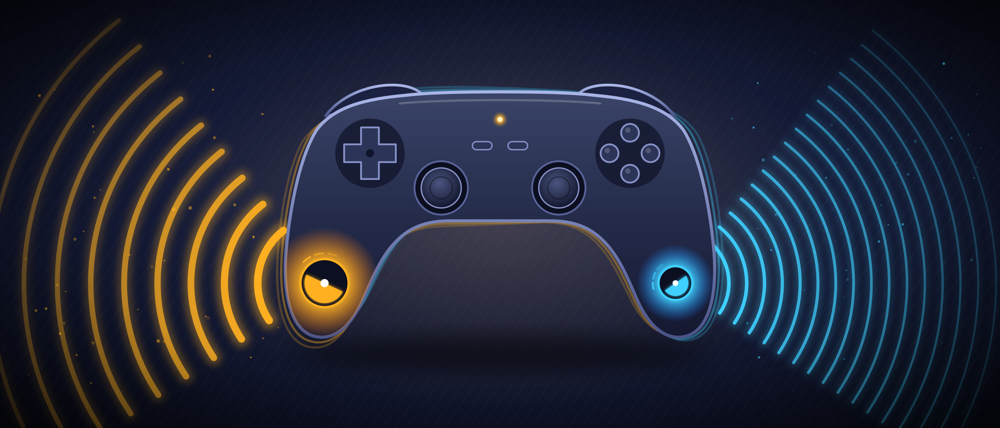

# Rumble

Controller rumble for Ratchet & Clank, which never had any, in the style of Going Commando.

## What it does

Ratchet & Clank never drives the controller's motors; Going Commando does. This mod plays rumble
for the same kind of moments in Ratchet & Clank, on Going Commando's own vibration mixer:

- **Hits taken:** a jolt, stronger and longer for a heavier hit, and a long one as Ratchet dies.
- **Jumps:** a low push while the Thruster-Pack's long jump lasts, and a flick for a wall jump.
  Ordinary, high and double jumps stay quiet, as in Going Commando.
- **The wrench:** a knock each time it connects (swung or thrown), and a thump as the wrench slam
  strikes the ground.
- **Kills and crates:** a short bump for each enemy killed and each crate broken.
- **Weapons:** a kick per shot, light for the Blaster, heavier for the Bomb Glove and Walloper,
  strongest for the Devastator and the R.Y.N.O. While the Pyrocitor, Tesla Claw or Morph-o-Ray
  fires, a steady buzz that stops as you let go of the button.
- **Explosions and camera shake:** rumble as strong as the camera's shake, for explosions near it,
  quakes and scripted moments.
- **Rails and swimming:** a low rattle while grinding, and a push while the Hydro-Pack dashes
  Ratchet under water.
- **Hover hum** (off by default): a faint hum while the Thruster-Pack's hover or the Heli-Pack's
  glide holds Ratchet up.

Nothing rumbles in the pause menu, a vendor, a dialog, a cutscene or a level load, or while Ratchet
is dead.

## How to use it

Switch it on and play. Your vibration settings in OpenRAC's Controls menu apply; with the mod
loaded they show up for Ratchet & Clank too.

## Settings

Changes take effect while the game runs.

| Setting | Default | Choices | What it does |
|---|---|---|---|
| Strength | 100 | 0 to 100 (%) | How strong the rumble is. |
| Hits taken | On | On, Off | A jolt for each hit, and a long one as Ratchet dies. |
| Jumps | On | On, Off | The long jump's push and the wall jump's flick. |
| Wrench and kills | On | On, Off | The wrench's knock, the wrench slam's thump, and a bump per kill or broken crate. |
| Weapons | On | On, Off | A kick per shot, and the stream weapons' buzz. |
| Explosions and camera shake | On | On, Off | Rumble with the camera's shake. |
| Rails and swimming | On | On, Off | The rail grind's rattle and the Hydro-Pack dash's push. |
| Hover hum | Off | On, Off | A faint hum while a pack holds Ratchet up. Not Going Commando's: it has none. |

## Requirements

- **OpenRAC with mod interface 1.37.** A game without it refuses the mod and says why.
- **Ratchet & Clank**, PAL and NTSC-U.
- **Works with [Thruster Charge](https://github.com/Promises/rac1-thruster-charge)** (optional):
  its charge rumbles through this mod, scaled by **Strength**. With **Hover hum** on, a charge also
  hums, since it runs in the hover's state.

## Compatibility and known issues

- No conflicts with other mods are declared.
- **dualsense mod:** it plays a vibration of its own on a DualSense. Both load together, but on a
  DualSense they fight over the same motors: turn off its **Vibration** setting, or this mod.
- **Vehicles:** the Hoverboard races and the ship fights rumble only through the camera's shake for
  now. Going Commando's vehicle rumble is planned for a later version.
- An explosion out of view (one that does not shake the camera) does not rumble.

## Credits

By Henning Berge. The vibration mixer is Going Commando's, from OpenRAC's
[rac2-decomp](https://github.com/OpenRAC/rac2-decomp); it follows Ratchet & Clank's own, from
OpenRAC's [rac1-decomp](https://github.com/OpenRAC/rac1-decomp), adapted from Lombyte's NTSC-U
decompilation.

Licence: GPL-3.0 (details in the [README](README.md#license) and
[THIRD_PARTY_NOTICES.md](THIRD_PARTY_NOTICES.md)).

## Feedback

Found a bug or have an idea? Open an issue on
[GitHub](https://github.com/Promises/rac1-rumble/issues). Pull requests are welcome.

Developer documentation: [README](README.md)
