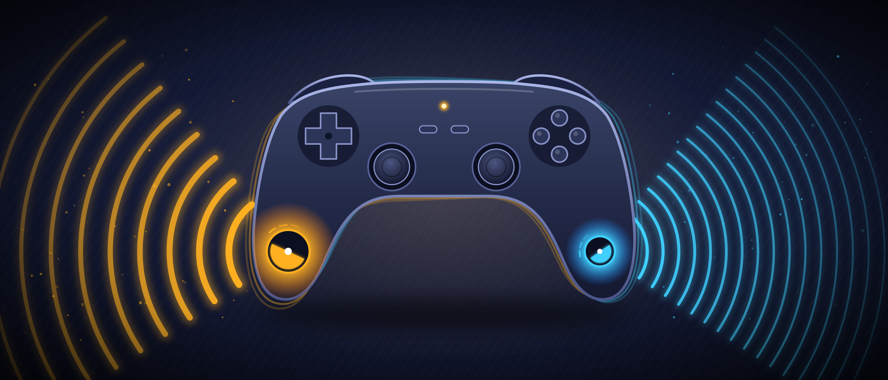

# Rumble



A native mod for [OpenRAC](https://github.com/OpenRAC/OpenRAC)'s port of Ratchet & Clank:
**controller rumble in the style of Going Commando**. Ratchet & Clank has a vibration mixer, but the
retail game never drives the pad's motors; Going Commando does, for hits, hard landings, explosions
and its weapons. This mod plays rumble for the same kind of moments in Ratchet & Clank, on Going
Commando's own mixer, copied from its decompilation. PAL and NTSC-U.

## What rumbles

- **Hits taken**: a jolt that eases off over a third of a second, both motors; a heavier hit (the
  game's damage 2 or more) is stronger and longer. Dying: a long jolt, then nothing.
- **Hard landings**: after a long, fast fall (0.6 seconds or more coming down, at 12 units a second
  or faster), a thud on the large motor, stronger and longer the longer he fell, both motors from
  about a second down. Ordinary jumps, double jumps and Heli-Pack glides land quietly, and so does a
  fall that ends on a ledge or in water.
- **Jumps**, where Going Commando kicks for its own: a short kick as the Thruster-Pack's long jump
  starts (and the jump that shares its kick in Going Commando, state 0xD), a lighter one for a wall
  jump. Ordinary jumps, high jumps and double jumps stay quiet, as in Going Commando.
- **The wrench**: a short knock each time it connects with an enemy, a crate or a wall (swung or
  thrown), and a thump as the wrench slam strikes the ground.
- **Kills and crates**: a short bump for each enemy killed and each crate broken.
- **Weapons**, a kick per shot by weapon: light for the Blaster, Mine Glove, Decoy Glove, Drone
  Device, Taunter and Suck Cannon; heavier for the Bomb Glove, Visibomb Gun, Walloper and Glove of
  Doom; strongest for the Devastator and the R.Y.N.O. While the Pyrocitor, Tesla Claw or
  Morph-o-Ray fires, a steady low buzz of its own (a roar, a crackle, a hum).
- **Explosions and camera shake**: the game shakes its camera for explosions near it, quakes and
  scripted moments; the large motor follows the shake, as strong as it is, and the small one joins
  in for the strongest. Going Commando pairs its rumble with the camera's shake the same way.
- **Rails and swimming**: a low rattle while Ratchet grinds, and a steady push while the Hydro-Pack
  dashes him under water (Going Commando rumbles through its own dash).
- **Hover hum** (off by default): a faint, steady hum while the Thruster-Pack's hover or the
  Heli-Pack's glide holds him up. This one is not Going Commando's, which has none. With the
  Thruster Charge mod, its charge runs in the hover's state, so it hums too.

Nothing rumbles in the pause menu, a vendor, a dialog, a cutscene or a level load, nor while Ratchet
is dead; what was playing stops at once and does not come back after.

## Settings

In the launcher's Mods tab, read again whenever they change while the game runs:

- **Strength** (0 to 100%, default 100): the large motor's strength scales; the small motor is only
  on or off, and drops out below about 40%.
- **Hits taken**, **Hard landings**, **Jumps**, **Wrench and kills**, **Weapons**, **Explosions and
  camera shake**, **Rails and swimming**: each on by default.
- **Hover hum**: off by default.

The player's own rumble setting in OpenRAC applies on top.

## Needs

**OpenRAC with mod interface 1.37**, for `set_motors`, the call that drives the pads' motors:
OpenRAC pull request #803 (interface 1.36) and the `set_motors` pull request stacked on it (1.37),
until a release has them. A port without it refuses the mod and says why.

The `dualsense` mod has a vibration of its own (hits, crates, pickups) that it plays on a DualSense
through SDL itself, past `set_motors`. The two load together (no conflict is declared), but on a
DualSense both then write the same motors and the last write wins: turn off its **Vibration**
setting, or this mod, there.

## How it works

Going Commando's mixer, `LevelActuatorCalcPower`, mixes eight wave channels (square, triangle,
rising and falling saw, cosine; each on the small or the large motor, with a delay, a duration, an
amplitude and a bias) into one value per motor each tick. A channel counts its duration down and
empties, unless it is permanent: then it plays until it is stopped. Ratchet & Clank has the same
mixer without permanent channels (`actuator_CalcPower`), and nothing calls it; Going Commando drives
its mixer with a pattern player whose patterns are data on its disc. The mod copies Going
Commando's mixer (`src/actuator.c`, unchanged but for its channel array being a parameter) and
plays its own patterns on it (`src/rumble.hpp`), in two banks: one for short events, and one for
what lasts, a permanent wave started as a stream weapon starts firing or Ratchet lands on a rail,
and stopped as it stops. The mixer averages the waves on a motor, so a buzz in the same bank as a
hit would halve it; the two banks and the camera's shake are joined by the stronger instead.

Where the moments come from:

| Moment | From |
|---|---|
| Hits taken | `rac1.player.take_damage`, its damage |
| Dying | the hero's state (dying, drowning, a fatal fall...) or no health, each tick |
| Hard landings | the hero's time off the ground and his speed downward, each tick |
| Jumps | `rac1.player.enter_move_state`: states 0x10 (the Thruster-Pack's long jump), 0xD and 0x11 (the wall jump) taken |
| The wrench | `rac1.moby.wrench.update`: the wrench's hit latch (`Hero.unkA64`) set during its update |
| The wrench slam | the hero in state 0x14 with his animation passing frame 27 this tick, where `wrench_update` strikes the ground |
| Kills and crates | `rac1.moby.record_death` |
| Weapons | `rac1.weapon.take_ammo` (a shot taken), by the weapon in hand |
| Camera shake | the level camera's two shake channels, each tick: amplitude times (frames left / frames)², as the game's `apply_camera_shake` scales its shake |
| Rails, the Hydro-Pack's dash, the hover | the hero's state (grinding; 0x35; 0x81 or 0x8), each tick |
| Quiet | `play_status`: only in play, not paused, in a menu or a scene |

After each tick the motors get the mix (`set_motors`, every tick while it plays, as a command holds
a fifth of a second; then 0, 0 once).

### Going Commando's rumble, and what is here

Going Commando starts its patterns from these places (rac2-decomp, USA v1.01, in the code it has
decompiled; its PAL and v2.00 builds call them from the same functions). Its pattern data is on its disc, so the strengths here are
this mod's, kept in the same order.

| Going Commando | Ratchet & Clank | Here |
|---|---|---|
| Pattern 18: hit taken (hero states 0x16 and 0x8C, as it takes the health) | `take_damage` | Hits taken |
| Pattern 20: entering 0x10 and 0xD (the same states in Ratchet & Clank, the same heights and trails) | 0x10 the Thruster-Pack's long jump, 0xD | Jumps |
| Pattern 27: entering 0x11 | 0x11, the wall jump | Jumps (lighter) |
| Pattern 25: the wrench slam (0x14) striking the ground, with a camera shake | 0x14, frame 27 | Wrench and kills |
| Pattern 22 each tick of the swim dash (0x34) | 0x35, the Hydro-Pack's dash | Rails and swimming |
| Pattern 19: entering 0x1F with a gadget in hand (its animation 0x60) | none found: Ratchet & Clank's 0x1F is an idle wait | not here |
| Weapon patterns, started as they fire and stopped by handle (`minirocket_tube_update`, `blitz_gun_update`, `lancer_update`, `mini_l00_nuke_update`, `UpdateLockOnWeapon`, `UpdateSpreadWeapon`, `UpdateScopedWeapon`, `vaporizer_update`, `gravity_bomb_launcher_update`, `bouncer_update`, `charging_weapon_update`, `megarocket_cannon_update`) | Ratchet & Clank's weapons, through `take_ammo` | Weapons |
| Hoverbike race: a rocket fired (47), a crash with its explosion (28) | the Hoverboard races: no hook point at a crash | camera shake only, if any |
| Space combat (Feltzin, the orbits): the ship's weapons, hits and collisions, boss parts (22, 25, 43) | none: Ratchet & Clank has no space combat | not here |
| Oozla's ferry and the grabber (4, 5, 7, level patterns) | none | not here |
| All patterns cleared as the hero changes state (unless a slam's lock holds them) | | not copied: patterns here run their length |

Not Going Commando's (none of its decompiled code rumbles for them): hard landings, kills and crates, rails, the camera's shake followed as a
level, the stream weapons' buzz, the hover hum.

The game has no hook point at its explosion spawn; explosions reach the rumble through the camera's
shake, so one out of view (which shakes nothing) does not rumble. A hook point there would be an
OpenRAC addition.

## Build

```sh
python3 tools/fetch_sdk.py          # the SDK sdk.lock pins, into .sdk/
cmake -S . -B build -G Ninja
cmake --build build && ctest --test-dir build
python3 .sdk/openrac-mod-sdk-*/tools/package_mod.py build/package/rumble
```

## Credits

The mixer is Going Commando's, from OpenRAC's [rac2-decomp](https://github.com/OpenRAC/rac2-decomp)
(GPL-3.0); it follows Ratchet & Clank's own, which OpenRAC's
[rac1-decomp](https://github.com/OpenRAC/rac1-decomp) (GPL-3.0) adapted from Lombyte's NTSC-U
decompilation (GPL-3.0). The game's memory layout and hero states are rac1-decomp's.

## License

GNU General Public License version 3 ([LICENSE](LICENSE)). The files copied from rac2-decomp are
GPL-3.0-only, as that project gives no later version; the mod's own files are GPL-3.0-or-later.
[THIRD_PARTY_NOTICES.md](THIRD_PARTY_NOTICES.md) names the source, its commit and the lines copied;
the package carries it as `LICENSE.THIRD_PARTY_NOTICES.md`.
